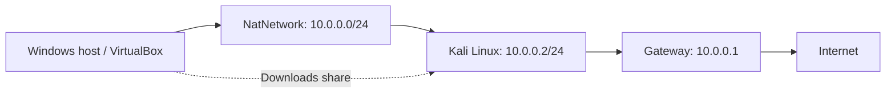
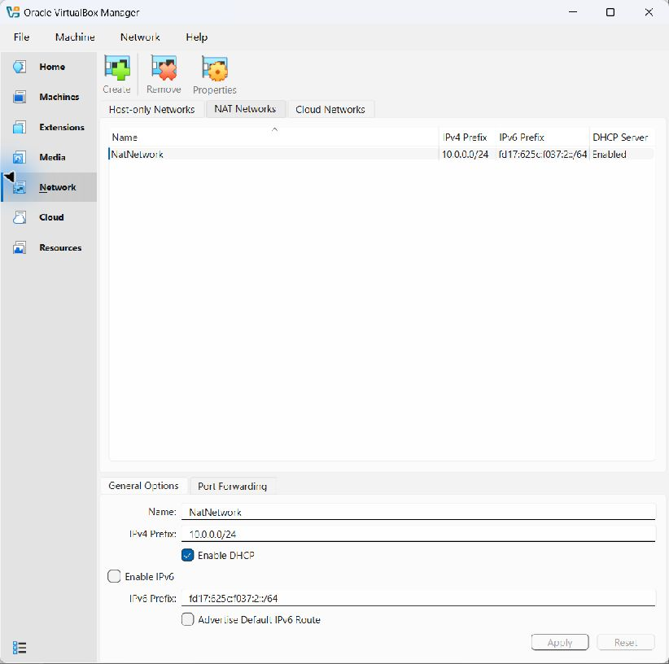
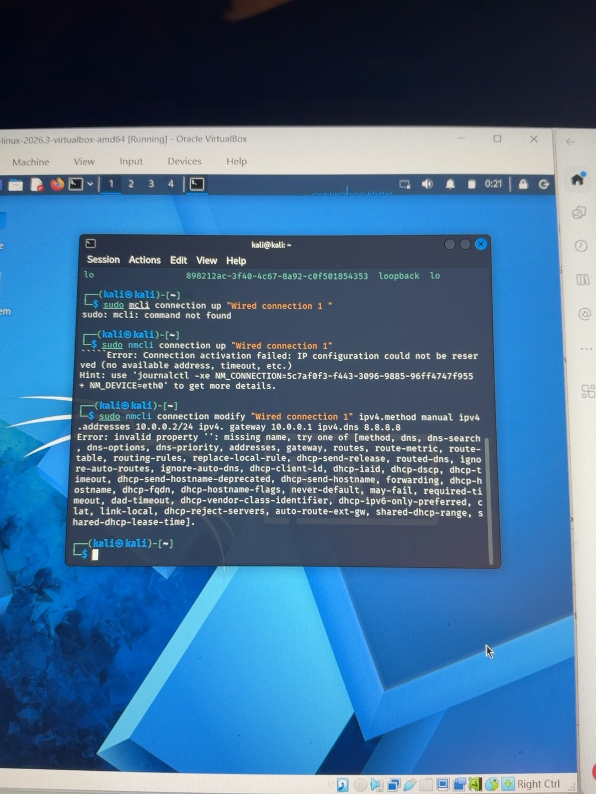

# NetworkWalks Week 1: Cybersecurity Lab Setup

**Sujal K Rao | Batch B084D | WK1-PM1**

A Kali Linux training lab on Oracle VirtualBox, documented with live verification results and genuine screenshots. Configuration and connectivity were checked on **October 27, 2026**.

## Project Overview

This project establishes the virtual environment for my NetworkWalks cybersecurity internship. Kali runs on my own Windows computer in a dedicated NAT Network. This submission covers Week 1; additional Windows and Android guests are optional future work.

## Objectives

- Run Kali Linux in VirtualBox on the required NAT Network.
- Configure the required static IPv4 address and verify internet access.
- Enable host/guest integration and share the Downloads folder.
- Preserve a VM snapshot and document actual troubleshooting.

## Purpose and Architecture

The environment supports Linux administration, networking, and future authorized security exercises on my own systems. A NAT Network provides outbound connectivity and can support additional lab guests. It is not an air gap: the configured shared folder and clipboard also connect the guest with the host.

This is a configuration diagram, not a screenshot or captured test output.

## Lab Configuration

| Component | Verified value |
| --- | --- |
| Hypervisor | Oracle VirtualBox 7.2.22r175245 |
| Guest OS | Kali GNU/Linux Rolling 2026.3 |
| VM | `kali-linux-2026.3-virtualbox-amd64` |
| Resources | 2 virtual CPUs; 2048 MB RAM |
| Adapter | NAT Network `NatNetwork`, cable connected |
| Network / gateway | `10.0.0.0/24` / `10.0.0.1` |
| Kali addressing | Manual; `10.0.0.2/24` on `eth0` |
| DNS | `8.8.8.8` |
| NAT DHCP | Enabled; Kali's active profile is manual |
| Clipboard / drag and drop | Both configured bidirectional |
| Shared folder | Host Downloads, mounted at `/media/sf_Downloads` |
| Existing snapshot | `Kali - Network Working` |

## Lab Setup Procedure

The procedure below documents the existing working configuration. It does not reconstruct unrecorded installation steps.

1. **Prepare VirtualBox and Kali.** The Kali VM is present and boots with the resources above. The guide lists 7-Zip for extracting the VM archive; the original extraction was not observed.
2. **Configure the NAT Network.** `NatNetwork` uses `10.0.0.0/24` with DHCP enabled and IPv6 disabled.
3. **Attach the VM.** Adapter 1 is connected to `NatNetwork` with its cable connected.
4. **Configure the guest.** The active NetworkManager profile uses manual addressing, `10.0.0.2/24`, gateway `10.0.0.1`, and DNS `8.8.8.8`. Its current `ipv4.dad-timeout` value is `0`.
5. **Enable integration.** Clipboard and drag/drop are bidirectional. Downloads is mounted in Kali, and the `kali` user belongs to `vboxsf`.
6. **Keep a recovery point.** The existing current snapshot is named `Kali - Network Working`.

### Current NAT Network screenshot

*Captured from this computer's VirtualBox Manager. Other current settings and guest tests are supplied as actual command output below, not reconstructed terminal images.*

## Lab Verification

Live checks were run against the existing VM at approximately 05:01-05:03 UTC on October 27, 2026. The VM was started for verification; no configuration changes were made.

| Check | Observed result | Evidence |
| --- | --- | --- |
| Guest address | `eth0` UP, `10.0.0.2/24` | [Guest checks](evidence/guest-verification.txt) |
| Addressing / route | Manual; default via `10.0.0.1` | [Guest checks](evidence/guest-verification.txt) |
| Gateway ping | 3 sent, 3 received, 0% loss | [Guest checks](evidence/guest-verification.txt) |
| External IP ping | 3 sent, 3 received, 0% loss | [Guest checks](evidence/guest-verification.txt) |
| DNS | `example.com` resolved | [Guest checks](evidence/guest-verification.txt) |
| HTTPS | `example.com` returned HTTP/2 200 | [Guest checks](evidence/guest-verification.txt) |
| Shared folder | `vboxsf` mount; read/traverse checks passed | [Share checks](evidence/shared-folder-verification.txt) |
| Clipboard / drag/drop | Bidirectional settings confirmed | [VM settings](evidence/virtualbox-settings.txt) |
| Snapshot | Existing current snapshot confirmed | [Snapshot listing](evidence/snapshot.txt) |
| Nmap availability | Version 7.991 | [Version output](evidence/nmap-version.txt) |

**Limits:** clipboard and drag/drop transfers were not exercised; no personal shared-folder files were opened or transferred; no snapshot restore was performed. Successful DNS, ping, and HTTPS checks establish connectivity to the tested destinations, not every possible service. No security scan was run.

## Problems Encountered and Solutions

During setup, a terminal screenshot recorded a mistyped `mcli` command, an IP activation error, and a space splitting `ipv4.gateway`. The syntax corrections are to use `nmcli` and write `ipv4.gateway` as one property name.

The current working profile has `ipv4.dad-timeout=0`, which matches the guide's workaround. Live network tests now pass. The exact earlier repair sequence was not preserved, so recovery cannot be attributed to one command alone. See the [troubleshooting notes](docs/troubleshooting.md).

*Original user-supplied screenshot from before recovery. It records failed attempts and is not proof of the current network state.*

## What I Learned

- Command and property names must be exact; small typing errors can prevent a configuration command from running.
- VM adapter settings, guest IP configuration, DNS, and actual internet requests need separate checks.
- A saved snapshot provides a recovery point, but its existence is different from a tested restore.
- Clear documentation distinguishes observed results from assumptions and retains the troubleshooting history.

## Security and Ethical Use

This project uses my own computer and virtual machine for education. Future testing will remain within systems I own or have explicit permission to test. Verification used ordinary connectivity checks; no external systems were scanned or exploited.

## Tools and Resources

- NetworkWalks *Program Guide - Workflows - Cybersecurity Int v2.2b(2)*, pp. 8-10.
- NetworkWalks *WK1-PM1 - Lab Setup Virtualbox and Kali Linux v4.2*, pp. 1-8.
- [Week 1 project video](https://www.youtube.com/watch?v=K6rMQdg10Zk)
- [Oracle VirtualBox](https://www.virtualbox.org/)
- [Kali Linux](https://www.kali.org/)
- [Evidence index and limitations](evidence/README.md)
- [Requirement checklist](docs/evidence-checklist.md)

## Author and Project Information

**Sujal K Rao** - NetworkWalks Cybersecurity Internship, Batch **B084D**, Week **1**, Project Module **1**.

[GitHub](https://github.com/sujalrao061) | [LinkedIn](https://www.linkedin.com/in/sujal-rao/)

